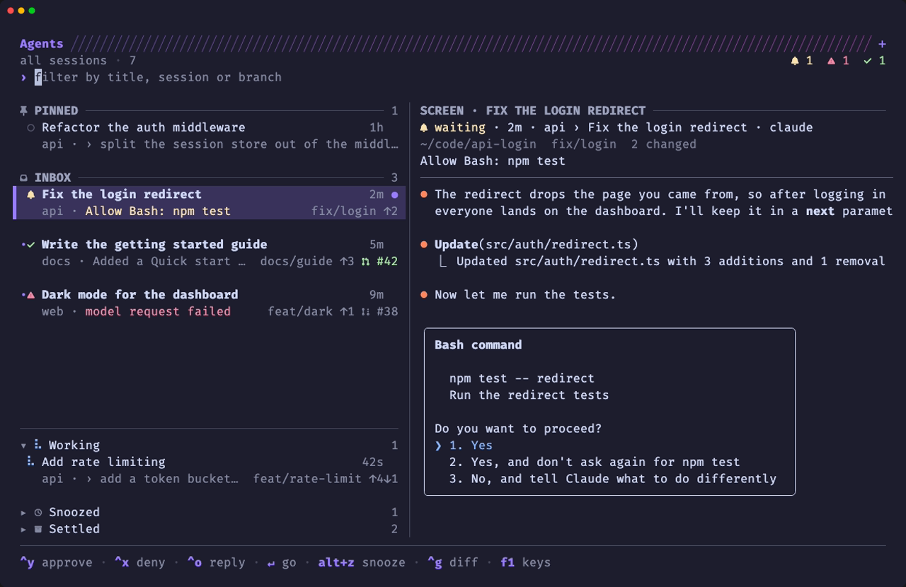
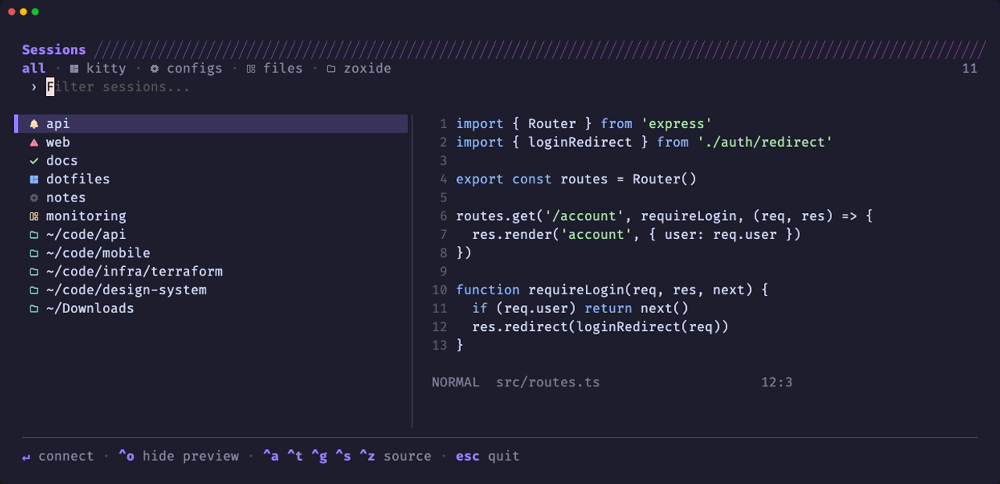
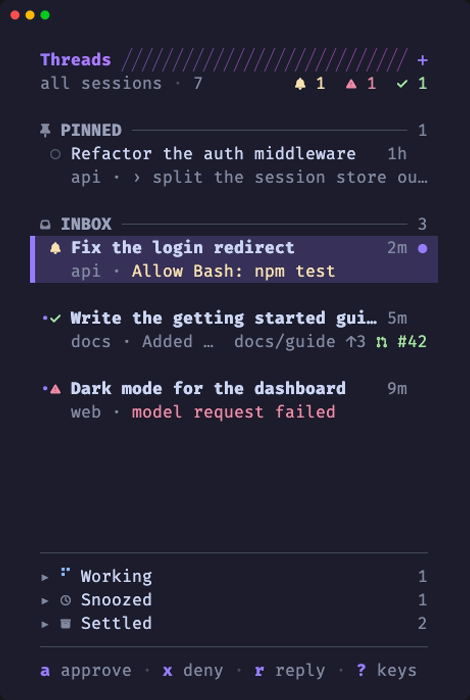

# ksesh

**A smart session manager for [kitty](https://sw.kovidgoyal.net/kitty/), with a home for your coding agents.**

ksesh is a port of [sesh](https://github.com/joshmedeski/sesh) that uses
**kitty's own sessions** instead of tmux. Jump to any project with a fuzzy
picker, and keep track of every Claude Code, Codex or Gemini CLI agent you
have running, from a sidebar in every tab.



## What you get

- **Sessions without tmux.** Every session ksesh opens is a real kitty
  session, so kitty's own `goto_session`, `tab_bar_filter session:…` and
  `{session_name}` work with it.
- **A fuzzy session picker** (`cmd+p`) over your running sessions, configured
  projects, kitty session files and zoxide directories, with a live preview.
- **Agent status everywhere.** Each agent shows whether it is working, waiting
  on you, done or failed: in the tab bar, in desktop notifications, and in the
  pickers.
- **A thread sidebar** (`cmd+b`) that triages your agents the way
  [T3 Code](https://github.com/pingdotgg/t3code) triages threads: pin, snooze
  and settle them, see their branch and pull request, and approve, deny or
  reply without leaving the window you're in.
- **An agent picker** (`cmd+a`) with each agent's screen, or its diff, beside
  the list.
- **Git worktrees as sessions**, with an agent already started in them.
- **Other machines too.** Open a project on a server over SSH from the
  picker; agents running there show up in your sidebar like local ones.
- **All of sesh's features**: zoxide, config sessions, startup commands,
  windows, wildcards, aliases, previews and caching. Your `sesh.toml` works as
  is.

## Contents

- [Requirements](#requirements)
- [Quick start](#quick-start)
- [Keys](#keys)
- [Sessions](#sessions)
- [Agents](#agents)
- [The thread sidebar](#the-thread-sidebar)
- [Worktrees](#worktrees)
- [Remote machines](#remote-machines)
- [Configuration](#configuration)
- [Coming from sesh](#coming-from-sesh)
- [Troubleshooting](#troubleshooting)
- [How it works](#how-it-works)
- [Development](#development)

## Requirements

| what                                    | needed for                                 |
| --------------------------------------- | ------------------------------------------ |
| [kitty](https://sw.kovidgoyal.net/kitty/) **0.43+** | sessions (**0.50+** for the sidebar) |
| [zoxide](https://github.com/ajeetdsouza/zoxide)     | directories you use, in the picker   |
| [Go](https://go.dev) 1.26 and [just](https://github.com/casey/just) | building ksesh |
| `git` (optional)                        | worktrees, branches in the sidebar         |
| [`gh`](https://cli.github.com) (optional) | pull requests in the sidebar and `ksesh wt` |
| [delta](https://github.com/dandavison/delta) (optional) | syntax highlighted diffs   |

## Quick start

```sh
git clone https://github.com/xheisenbugx/ksesh && cd ksesh
just install
```

That builds `ksesh` into `~/.local/bin` and runs `ksesh setup`, which wires
kitty up for you:

- it writes `ksesh.conf` (ksesh's kitty settings and keys) next to your
  `kitty.conf`, and includes it at the end of `kitty.conf`;
- it installs the tab bar, watcher and pickers next to them;
- it adds `sessions/main.kitty-session`, the session kitty starts in, if you
  don't have one;
- it installs the hooks that report Claude Code's status. Add
  `just install --codex` or `--gemini` for those agents.

**The first time, quit kitty and start it again**: kitty only opens the socket
ksesh talks to when it starts. After that, setup reloads kitty itself.

Then try it:

1. Press **`cmd+p`** and pick a project. ksesh opens it as a session.
2. Start an agent in it (`claude`) and press **`cmd+b`** to see it in the
   sidebar.
3. When an agent waits on you, press **`cmd+j`** to jump to it, or approve it
   from the sidebar with **`a`**.

To update later: `git pull && just install`. Setup only changes what is out of
date, and keeps a `.bak` of any file you edited by hand before replacing it.
`ksesh setup --dry-run` shows what it would change, and
`ksesh setup --uninstall` takes it all out again.

<details>
<summary>Without <code>just</code></summary>

```sh
go build -o ~/.local/bin/ksesh . && ~/.local/bin/ksesh setup
```

`KSESH_BIN` changes where `just install` puts the binary.
</details>

## Keys

`ksesh setup` maps these (`cmd` is kitty's `super`):

| key                          | does                                           |
| ---------------------------- | ---------------------------------------------- |
| `cmd+p`                      | session picker                                 |
| `cmd+shift+p`                | back to the previous session                   |
| `cmd+shift+r`                | rename the session                             |
| `cmd+a`                      | agent picker                                   |
| `cmd+j` / `cmd+shift+j`      | the agent that needs you next / the one before |
| `cmd+b`                      | show or hide the sidebar in every tab          |
| `cmd+shift+b`                | into the tab's sidebar and back out            |
| `cmd+ctrl+p` `s` `z` `w`     | pin, settle, snooze for an hour, wake the thread you're in |
| `cmd+ctrl+j` / `k` / `1`–`9` | next, previous, nth thread of the sidebar      |
| `cmd+t` / `cmd+enter`        | new tab / new window in the session you're in  |

Pressed in the sidebar, `cmd+p` and `cmd+a` open over the window beside it.

**To change a key**, put yours in `ksesh-local.conf`, next to `ksesh.conf`.
kitty reads it last, and `ksesh setup` never touches it. For instance, on
Linux:

```conf
map ctrl+alt+b launch --type=background --allow-remote-control ksesh sidebar toggle
```

## Sessions

Everything from sesh works the same way; only the multiplexer changed.

```sh
ksesh connect <name|dir>   # switch to a session, creating it when needed
ksesh picker -i --preview  # the session picker (cmd+p)
ksesh last                 # the session you were in before this one
ksesh list                 # sessions from kitty, config, session files and zoxide
ksesh list -t              # only running kitty sessions (-c config, -T session files, -z zoxide)
ksesh kill [name]          # close a session's windows (the current one without a name)
ksesh rename --to <name>   # rename the current session
ksesh mkdir <path>         # mkdir, then connect
ksesh clone <repo>         # git clone, then connect
ksesh preview <name>       # a session's screen, or a directory listing
ksesh tab connect logs     # select the "logs" tab, creating it if missing
ksesh tab connect ~/c/api -c 'npm run dev'
```

### The session picker



`cmd+p` lists everything (`sort_order` sets the order). Type to filter, then:

| key                            | does                                         |
| ------------------------------ | -------------------------------------------- |
| `enter`                        | go to the session                            |
| `ctrl+a` `t` `g` `s` `z`       | show all, kitty sessions, configs, session files, zoxide |
| `ctrl+r`                       | directories on your [other machines](#remote-machines) |
| `ctrl+x`                       | kill the session, or forget a zoxide directory |
| `ctrl+o`                       | show or hide the preview                     |
| `esc`                          | quit                                         |

A session with an agent shows the agent's status in place of its icon, and
sessions that need you are listed first.

Prefer fzf? [`contrib/ksesh-fzf`](contrib/ksesh-fzf) is installed next to
`ksesh.conf`; bind it in `ksesh-local.conf`. Or simply:

```sh
ksesh connect "$(ksesh list -i | fzf --ansi --no-sort)"
```

### Outside kitty

ksesh also works from another terminal or a launcher: it reaches kitty through
`$KITTY_LISTEN_ON` or the `kitty_socket` option, and brings kitty to the front
after switching. If no kitty is running, `ksesh connect` starts one.

## Agents

ksesh tracks the coding agents running in kitty, so you can see at a glance
which one needs you and go straight to it.

### Setting up an agent

`just install` already sets up Claude Code. For the others:

```sh
ksesh agent install --codex    # or --gemini, or --all
```

| agent       | working                         | waiting                     | done           | error       |
| ----------- | ------------------------------- | --------------------------- | -------------- | ----------- |
| Claude Code | prompt sent, tool ran           | permission prompt, question | stop           | API failure |
| Codex       | prompt sent, tool ran, answered | approval request            | stop           | request failed |
| Gemini CLI  | prompt sent, tool started       | tool confirmation           | agent finished | —           |

ksesh adds its hooks next to yours and backs up the file it changes;
`ksesh agent uninstall` removes them.

- **Claude Code**: `~/.claude/settings.json` (or `--settings`).
- **Codex**: `~/.codex/hooks.json` (`$CODEX_HOME`, or `--codex-home`). Codex
  only runs hooks you trust, so **open `/hooks` in Codex once and trust
  ksesh's**. If your `config.toml` already has a `[hooks]` table, ksesh adds a
  marked block at its end instead.
- **Gemini CLI**: `~/.gemini/settings.json` (or `--gemini-settings`). ksesh
  can't edit a `settings.json` with comments in it.
- **Anything else** can report its status with `ksesh agent set waiting -m "…"`
  from its own hooks. Agents without hooks (aider, opencode, …) are still
  listed, as idle.

### Where you see it

- **In the tab bar**: a status icon on every tab with an agent, and at the
  right end, an **attention strip** naming the *other* sessions with an agent
  waiting on you or failed.
- **As a desktop notification**, when an agent starts waiting, fails or
  finishes while you aren't looking at it. Clicking it takes you there. Turns
  shorter than 30 seconds don't notify.
- **In the pickers and the sidebar**, with what the agent needs: a permission
  prompt says what it would allow (`Allow Bash: npm test`), so you can answer
  it without switching.

A finished agent turns back to idle once you look at its window.

### The agent picker

`cmd+a` opens every agent in a full window, with the selected one's screen
beside the list (it's the screenshot at the top of this page). Type to filter (fzf style: `lgn` finds `login`), and:

| key                             | does                                          |
| ------------------------------- | --------------------------------------------- |
| `enter`                         | go to the agent (or resume a closed thread)   |
| `ctrl+y`                        | approve a waiting agent                       |
| `ctrl+x`                        | deny a waiting agent, interrupt a working one |
| `ctrl+o`                        | reply                                         |
| `ctrl+s`                        | mark a finished agent seen                    |
| `ctrl+g`                        | show its diff instead of its screen, and back |
| `alt+d`                         | the full review, in `less`                    |
| `ctrl+d` / `ctrl+u`             | scroll the preview                            |
| `alt+p` `alt+s` `alt+z` `alt+e` | pin, settle, snooze, wake                     |
| `alt+b`                         | open its pull request                         |
| `alt+w`                         | close its window                              |
| `alt+space` / `alt+m`           | its actions, by the sidebar's letters         |
| `f1`                            | every key                                     |

The actions menu takes the sidebar's letters (`a` approves, `p` pins, `d`
reviews…), so you only need to learn one set of keys: `space` then a
letter in the sidebar, `alt+space` then the same letter here.

It lists the same threads as the sidebar. Snoozed and settled ones start
folded away, and open as soon as you type, so they're always a search away.

### From the command line

```sh
ksesh agent list              # every agent, the ones that need you first (-A: only those)
ksesh agent next              # go to the one waiting longest; again for the next
ksesh agent last              # back to the agent you were with before
ksesh agent send 42 --key enter --if-status waiting   # approve window 42
ksesh agent send 42 "use the existing helper"          # reply to it
ksesh agent show 42           # its status, branch, changes and screen
ksesh agent diff 42           # review its work: branch, commits, files, diff
```

`ksesh agent diff` reviews an agent's work the way its pull request will be
reviewed: everything since its branch left the base, committed or not. It
goes through [delta](https://github.com/dandavison/delta) when installed, and
`--pager` opens it in `less`.

## The thread sidebar

With several agents going, a list sorted by urgency isn't enough. Some you
want kept in view, some out of the way until later, some you're done with.
The sidebar, docked to the side of every tab, sorts them into sections:

<p align="center">
  
</p>


| section     | holds                                                         |
| ----------- | ------------------------------------------------------------- |
| **Pinned**  | threads you pinned, in your order                             |
| **Inbox**   | everything else, the latest activity first                    |
| **Working** | agents busy on something that doesn't need you                |
| **Snoozed** | hidden until a time you picked, or until the agent needs you  |
| **Settled** | done with: settled by hand, after a week idle, or once its PR was merged |

Threads move on their own: sending an agent a prompt brings its thread back,
and an agent that starts waiting on you or fails wakes up from a snooze. A
thread that finished while you weren't looking is marked **unread** (`•`).

Each thread shows its title, how long ago it did something, its session, what
it needs or is doing, and, when it is on a branch of its own, the branch with
its commits ahead `↑` and behind `↓` and its pull request.

**Threads outlive their windows.** Close an agent's window, or quit kitty,
and its thread stays in Settled as a *closed* thread. `enter` resumes it with
`claude --resume`, in its session and directory.

### Sidebar keys

| key                     | does                                                   |
| ----------------------- | ------------------------------------------------------ |
| `enter` / click         | go to the thread (open a shelf, resume a closed thread) |
| `esc`                   | back to your window                                    |
| `j` `k` `g` `G` / `tab` | move / next section                                    |
| `1`–`9`                 | go to the nth thread                                   |
| `a` `x` `r`             | approve, deny or interrupt, reply                      |
| `p` / `K` `J`           | pin or unpin / move a pin up or down                   |
| `s`                     | settle or restore                                      |
| `z` / `w`               | snooze (1h, 3h, this evening, tomorrow, next week, or any time) / wake |
| `u`                     | undo the last pin, settle, snooze or wake              |
| `d`                     | review its changes                                     |
| `P`                     | open its pull request                                  |
| `n` / `N`               | new thread / new thread in a new worktree              |
| `R`                     | rename the thread                                      |
| `X`                     | close its window (or forget a closed thread)           |
| `A`                     | archive it: remove its worktree, branch and session    |
| `space` / `m` / right click | everything you can do to it, as a menu          |
| `/`                     | filter                                                 |
| `o` / `f`               | group the inbox by session / only this session         |
| `<` `>`                 | narrower, wider                                        |
| `q`                     | hide the sidebar everywhere                            |
| `?`                     | every key                                              |

The footer shows the keys for the selected thread's state: approve, deny
and reply when it is waiting, review and its PR when it is done, and `m
more` for the rest, the sidebar's own options (group, scope, width, hide)
among them.

The mouse works too: hover a thread for pin, snooze and settle buttons, and
click its `#12` to open its pull request.

### From the command line

Every action also works on the thread in the current window, or the one
given, so you can bind it in kitty:

```sh
ksesh agent pin [window-id]         # toggle
ksesh agent settle [window-id]      # toggle
ksesh agent snooze 3h [window-id]   # or evening, tomorrow, next-week, 90m, 15:04…
ksesh agent wake [window-id]
ksesh agent resume <conversation>   # resume a closed thread (an id prefix will do)
ksesh agent forget <conversation>   # drop it from the history
ksesh sidebar next / prev / goto 3  # move through the sidebar's order
ksesh sidebar print [--json]        # the threads, by section
```

## Worktrees

ksesh turns git worktrees into sessions, with an agent already working in
them:

```sh
ksesh wt new feat/login                        # a worktree and a session for a branch
ksesh wt new feat/login -p "add a login page"  # …with claude started on a prompt
ksesh wt new fix/typo --agent codex -b origin/release
ksesh wt status                                # every worktree: agent, changes, ↑↓ vs base
ksesh wt rm                                    # remove this worktree, its branch and session
ksesh wt rm --gone --merged                    # clean up the ones whose PR was merged
ksesh worktree connect 42                      # a worktree for GitHub issue or PR #42
```

`wt new` checks out the branch if it exists, locally or on `origin`, and
otherwise creates it from the base branch. By default worktrees go next to the
repo, in `<repo>__worktrees/<branch>`. Files listed in `.worktreeinclude` are
copied in from the main worktree.

`wt rm` refuses to remove a worktree with uncommitted changes, and keeps an
unmerged branch unless you pass `--force`. A branch whose upstream is gone
counts as merged, since a squash-merged PR never looks merged to git.

Set a repo up in `ksesh.toml`:

```toml
[[worktree]]
path = "~/c/app"
worktree_dir = "../app__worktrees"
copy = [".env", "config/*.local"]   # copied from the main worktree
symlink = ["node_modules"]          # linked instead
create_command = "pnpm install"     # run in the new session first
agent_command = "claude"            # then this
```

## Remote machines

Agents often run on a bigger machine than your laptop. ksesh can open
projects on other machines over SSH and track the agents running there, all
from your local kitty.

### Setting a machine up

1. **Add it to `ksesh.toml`**, by the name `ssh` knows it by:

   ```toml
   [[host]]
   name = "devbox"                     # a Host in ~/.ssh/config, or user@host
   paths = ["~/code/api", "/srv/app"]  # always listed; its zoxide directories are added
   ```

2. **Install ksesh on the machine**, and the agent hooks there. For a Linux
   server, from this repo:

   ```sh
   GOOS=linux GOARCH=amd64 go build -o /tmp/ksesh . && scp /tmp/ksesh devbox:.local/bin/
   ssh devbox ksesh agent install      # or --codex, --gemini, --all
   ```

   The machine needs `git`, and optionally `zoxide`. It doesn't need `gh`:
   pull requests are looked up from your laptop.

### Using it

- **Open a project there**: press `cmd+p`, then **`ctrl+r`** for the hosts
  tab, and pick a directory. Or `ksesh connect devbox:~/code/api`. It opens a
  kitty session named `api@devbox` running `kitten ssh devbox`, already in
  that directory.
- **Start an agent** in it as usual. Its status shows in the tab bar,
  notifications, the agent picker and the sidebar, and you can approve, deny
  or reply to it from there.
- **Branches, pull requests and reviews** work too: the sidebar asks the
  machine's ksesh about the branch, and `d` / `ctrl+g` review the work on the
  machine itself.
- **Closed threads resume on their machine**: `enter` opens a new `kitten ssh`
  window there and runs `claude --resume` once its shell is up.
- **`n` in the sidebar** next to a remote thread starts the new one on the
  same machine.

Already use `kitten ssh` your own way? Add `--kitten forward_remote_control=yes`
(or set it in kitty's `ssh.conf`), and agents started in that window report
here too.

Not yet: creating or archiving worktrees on another machine (`N` and `A` in
the sidebar), and agents that keep running after you disconnect.

> **Security**: forwarding kitty's remote control lets programs on that
> machine control your kitty. Only do it for machines you trust.

## Configuration

ksesh reads **`~/.config/ksesh/ksesh.toml`** (`$XDG_CONFIG_HOME/ksesh`). If
that file doesn't exist, it reads sesh's `~/.config/sesh/sesh.toml`, so an
existing sesh setup works unchanged. `--config` (`-C`) picks another file.

> **Note**: ksesh reads one file or the other, never both. Once you create
> `ksesh.toml`, copy over anything from `sesh.toml` you still want.

The schema, [`ksesh.schema.json`](ksesh.schema.json), gives you completion and
checks in editors that support it. Everything is optional:

```toml
#:schema https://raw.githubusercontent.com/xheisenbugx/ksesh/main/ksesh.schema.json

[default_session]
startup_command = "nvim"              # run in every new session

[[session]]
name = "dotfiles"
path = "~/dotfiles"
startup_command = "nvim"
alias = "d"
windows = ["agent", "server"]         # extra tabs, from [[window]] below

[[session]]
name = "work"
path = "~/c/work"
session_file = "~/c/work/work.kitty-session"  # build it from a kitty session file

[[window]]
name = "agent"
startup_script = "codex"

[[window]]
name = "server"

[tui]
show_icons = true
preview = true

[sidebar]
edge = "left"                # or "right"
width = "38"                 # columns, or a share of the tab: "20%"
auto_settle_after_days = 7   # 0 never settles a thread on its own
keep_closed = 200            # closed threads kept to resume; 0 keeps none
keep_closed_days = 30        # forget closed threads idle this long; 0 never

[picker]
open_shelves = ["working"]   # shelves the agent picker opens with: "working", "snoozed", "settled"

[[host]]
name = "devbox"              # another machine, as ssh knows it (see Remote machines)
paths = ["~/code/api"]       # always listed in the picker's hosts tab
zoxide = true                # also list the directories its zoxide knows
```

<details>
<summary>kitty options</summary>

```toml
kitty_socket = "unix:/tmp/kitty"   # reach kitty from outside it
new_os_window = false              # true: each new session gets its own OS window
session_file_dirs = ["~/.config/kitty/sessions"]
kitten_command = "kitten"
kitty_command = "kitty"            # used to start kitty when none is running
terminal = "kitty"                 # app brought forward when switching from outside kitty

[tui]
window_name_format = "{index}:{title}"  # {title} {index} {id} {cwd} {cwd_name} {active} {active_title}
```
</details>

Every other sesh option works as the
[sesh README](https://github.com/joshmedeski/sesh#configuration) describes:
`blacklist`, `sort_order` (sources `kitty`, `config`, `sessionfile`, `zoxide`;
sesh's `tmux` and `tmuxinator` names are accepted), `dir_length`,
`name_substitution`, `[[wildcard]]`, `cache`, `[frecency]`, aliases and
`import`.

### Kitty session files

Session files in `session_file_dirs` show up in the picker (`ctrl+s`, or
`ksesh list -T`), and connecting to one lets kitty build its layout. A session
is named after its file: `api.kitty-session` is `api`. To save your current
layout as one, use kitty's `save_as_session --use-foreground-process`.

## Coming from sesh

Your commands and config work the same; here's how sesh's tmux ideas map onto
kitty:

| sesh / tmux          | ksesh / kitty                                               |
| -------------------- | ----------------------------------------------------------- |
| tmux session         | kitty session: the windows kitty tags with the same name    |
| tmux window          | kitty tab (`ksesh tab`, or `ksesh window`)                  |
| tmux pane            | kitty window (`ksesh list -p`)                              |
| `switch-client`      | `goto_session`, so kitty's `goto_session -1` follows along  |
| `capture-pane`       | `kitten @ get-text`, for previews                           |
| tmuxinator projects  | kitty session files (`*.kitty-session`)                     |

What's different:

- `ksesh tab` replaces `sesh window` (`window` and `w` still work).
- tmuxinator and tmuxp are gone: use kitty session files and `session_file`.
- kitty can't rename a session, so `ksesh rename` keeps the new name in a
  user variable; kitty's own `goto_session` still uses the original one.
- `rename --to` is new; sesh only has `--enrich`.

## Troubleshooting

**Nothing happens when I press a key, or ksesh says it can't reach kitty.**
Quit kitty and start it again after the first `just install`: kitty only
opens its socket (`listen_on`) at start.

**My `ksesh.toml` settings don't apply.** Make sure the file is at
`~/.config/ksesh/ksesh.toml`. Unknown keys are ignored silently; add
`strict_mode = true` to have ksesh complain about them. And remember that
creating `ksesh.toml` stops ksesh from reading `sesh.toml`.

**The sidebar says a thread has no pull request.** The sidebar describes the
branch checked out in the thread's directory *now*. Pressing `P` asks GitHub
again and tells you why it found none: the directory is back on the base
branch, `gh` failed, or the branch has none.

**An agent on another machine doesn't show up.** Check that ksesh and its
hooks are installed there (`ssh devbox ksesh agent install`), and that its
window was opened by ksesh or with `kitten ssh --kitten
forward_remote_control=yes`.

**Codex's status never changes.** Open `/hooks` in Codex and trust ksesh's
hooks.

**I changed `tab_bar.py` or the watcher, and kitty still runs the old one.**
kitty loads them once. `kitten @ kitten ksesh_reload.py` reloads them without
losing your sessions.

**Can I use ksesh without `listen_on`?** Yes, from inside kitty with
`allow_remote_control yes`, but the sidebar and the agent hooks need a socket.

## How it works

<details>
<summary>Agent status</summary>

Each agent's hooks run `ksesh agent hook`, which stores its status on the
agent's own kitty window as user variables: `ksesh_status` (`working`,
`waiting`, `done`, `error` or `idle`), `ksesh_msg`, `ksesh_prompt`,
`ksesh_status_at` and `ksesh_turn_at`. The thread state (`ksesh_pin`,
`ksesh_snooze_until`, `ksesh_settled_at`, …) lives there too, so nothing has
to run on the side. [`contrib/ksesh_agents.py`](contrib/ksesh_agents.py), a
kitty watcher, draws the tab bar badges and sends the notifications.
</details>

<details>
<summary>The thread history</summary>

Claude Code names its conversation in every hook event, and
`ksesh agent hook` keeps a record of each one in
`~/.local/state/ksesh/threads/<conversation>.json`: where it ran, its session,
title, last status and triage state. That's how a thread outlives its window.
Agents that don't name their conversation are threads only while their window
lasts.
</details>

<details>
<summary>How the sidebar stays up to date</summary>

The sidebars don't poll kitty. The watcher's
[`ksesh_snapshot.py`](contrib/ksesh_snapshot.py) writes kitty's state to
`~/.local/state/ksesh/kitty-<pid>.json` a tenth of a second after anything a
sidebar shows changes, and the sidebars check that file five times a second
(every 5 seconds from a tab in the background). If the file is missing or
stale, they ask kitty with `kitten @ ls` instead.

Branches are read from git every 30 seconds and pull requests from GitHub
every 5 minutes (every minute for a branch without one), cached in
`~/.cache/ksesh` for every sidebar to share. Shared sidebar state, such as
which shelves are open, is in `~/.local/state/ksesh/sidebar.json`.

kitty can't resize a docked window, so `<` and `>` dock a new sidebar at the
new width. A running sidebar restarts itself into a new build of `ksesh`
within a couple of seconds of it being installed.
</details>

<details>
<summary>Without a socket</summary>

Without `listen_on`, ksesh talks to kitty through the terminal it runs in. A
TUI and `kitten @` can't share that, so the session picker snapshots kitty
before it draws and waits until it closes to kill sessions.
</details>

## Development

```sh
just test      # regenerate mocks, then run the tests with coverage
just mock      # regenerate mocks only
just build     # build to $GOPATH/bin
just install   # build to ~/.local/bin and run ksesh setup
just screenshots  # regenerate the README's screenshots
```

The screenshots in this README come from [`docs/demo`](docs/demo), which runs
the real sidebar and pickers on made-up data. `just screenshots` regenerates
them (it needs [vhs](https://github.com/charmbracelet/vhs) and FiraCode Nerd
Font).

ksesh needs Go 1.26 (if your default Go is newer, run
`GOTOOLCHAIN=go1.26.0 just test`). See [`CLAUDE.md`](CLAUDE.md) for a tour of
the code.

## Credits

ksesh is a fork of [sesh](https://github.com/joshmedeski/sesh) by Josh
Medeski, MIT licensed. The sidebar's look borrows from
[Crush](https://github.com/charmbracelet/crush), and its triage from
[T3 Code](https://github.com/pingdotgg/t3code).
